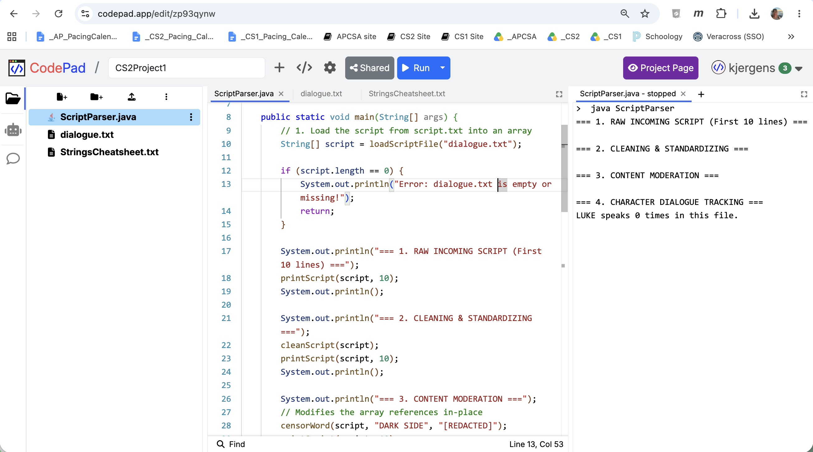

# Project 1: Script Parser

## Project Overview & Setup
For this project, you will create a text analysis program. 

**Summary:** You will store lines of a movie script inside a `String[]` array and pass that array through different methods. Because arrays in Java are passed by **reference**, any changes you make to the array inside a method will permanently change the original array in your `main` method.

**Setup:** 


1. Create a [CodePad.app](https://codepad.app/){:target="_blank"} account with your school Google Account.
1. Go to **MyPads** -> **+New Pad**
1. Select **Java** -> **Create**
1. Name the project `CS2Project1-YOURNAME`.
1. Select the three dots and **Rename** `Main.java` to `ScriptParser.java`
1. Paste the [Starter Code](https://codepad.app/edit/zp93qynw){:target="_blank"} 
1. Copy and paste the text file dialogue.txt.
1. Copy and paste the StringsCheatSheet.txt.
1. **Run** the program.  
   
Your setup is correct if you see the following:

```java
>  java ScriptParser 
=== 1. RAW INCOMING SCRIPT (First 10 lines) ===

=== 2. CLEANING & STANDARDIZING ===

=== 3. CONTENT MODERATION ===

=== 4. CHARACTER DIALOGUE TRACKING ===
LUKE speaks 0 times in this file.
```

---

## Method Requirements

Your program must include a **minimum of 4 distinct methods** (in addition to your `main` method). You must use these exact method setups:

### 1. printLineByLine
*   **Method Setup:** `public static void printLineByLine(String[] text)`
*   **What it does:** Uses a loop to go through the array and print each line. To make the output look clean, it must print a line number before each line of text (for example: `0: Is this the real life?`, `1: Is this just fantasy?`).

### 2. sanitizeText
*   **Method Setup:** `public static void sanitizeText(String[] text)`
*   **What it does:** Uses a loop to modify every single line directly inside the array. It must remove specific punctuation marks (periods, commas, and exclamation points) and change all the text to UPPERCASE letters.
*   *Note:* This method must be `void`. It changes the array elements directly without returning a new array.

### 3. encryptText
*   **Method Setup:** `public static void encryptText(String[] text, int shift)`
*   **What it does:** Uses a loop to modify every line in the array using a Caesar Cipher. It shifts every letter forward in the alphabet by the `shift` number. For example, if the shift is 1, 'A' becomes 'B', and 'B' becomes 'C'. Spaces should stay as spaces.
*   *Note:* This method must also be `void` and change the array directly.

### 4. findHighestDensity
*   **Method Setup:** `public static int findHighestDensity(String[] text, char target)`
*   **What it does:** Searches the array to find which line has the highest percentage of the `target` character compared to that line's total length. 
*   **Returns:** The integer index number of that line.

---

## Main Method Setup
Your `main` method should only act as a controller. It should not contain any loops or heavy math. It should only create the starting array, call your methods in order, and print plain labels to show how the data is changing.

### Expected Output Sequence
1. Print the original passage with line numbers.
2. Run the density analyzer and print which line number had the highest percentage of your target character.
3. Clean the text using `sanitizeText` and print it again to prove the array changed.
4. Encrypt the text using `encryptText` and print the final scrambled text.

---

## Starter Code

```java
/**
 * CS2 Project 1: The Crypto Mutator
 * Name: [Student Name]
 * 
 * --- WRITTEN REFLECTION ---
 * 1. Reference Trace: [Answer Here]
 * 
 * 2. State Snapshot (i == 2):
 *    - Value of i:
 *    - Value of text[i]:
 *    - State of local tracking variables:
 * 
 * 3. AI / Decomposition Defense: [Answer Here]
 */

public class CryptoMutator {

    public static void main(String[] args) {
        // Initialize text array with at least 5 lines of a poem, song, or quote
        String[] passage = {
            "Is this the real life?",
            "Is this just fantasy?",
            "Caught in a landslide,",
            "No escape from reality.",
            "Open your eyes,"
        };

        System.out.println("=== 1. ORIGINAL PASSAGE ===");
        printLineByLine(passage);
        System.out.println();

        System.out.println("=== 2. ANALYSIS ===");
        char targetChar = 's';
        int highDensityIndex = findHighestDensity(passage, targetChar);
        System.out.println("Highest density of '" + targetChar + "' found at Index: " + highDensityIndex);
        System.out.println();

        System.out.println("=== 3. SANITIZED PASSAGE (In-Place Change) ===");
        sanitizeText(passage);
        printLineByLine(passage);
        System.out.println();

        System.out.println("=== 4. ENCRYPTED PASSAGE (Shift = 3) ===");
        int shiftAmount = 3;
        encryptText(passage, shiftAmount);
        printLineByLine(passage);
    }

    public static void printLineByLine(String[] text) {
        // TODO: Implement loop to print text with line numbers
    }

    public static void sanitizeText(String[] text) {
        // TODO: Remove punctuation and convert to uppercase directly inside text[i]
    }

    public static void encryptText(String[] text, int shift) {
        // TODO: Implement alphabet shift loops directly inside text[i]
    }

    public static int findHighestDensity(String[] text, char target) {
        // TODO: Track max percentage using double math, return the best index
        return -1; 
    }
}
```
